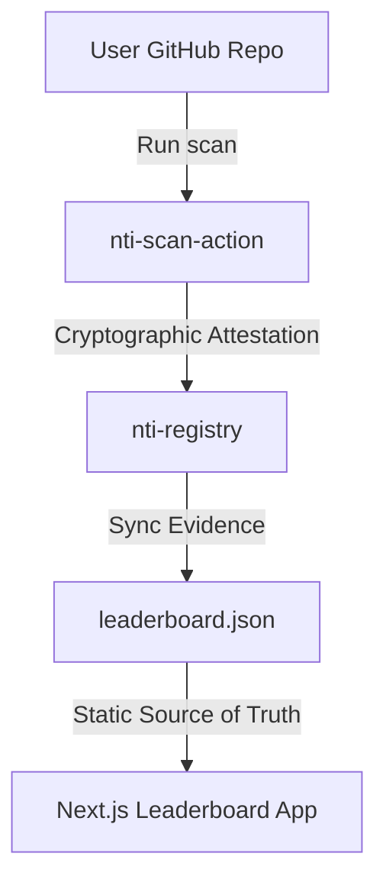

# nti-leaderboard

Cryptographically verifiable compliance leaderboard for AI agent frameworks.



## Overview

`nti-leaderboard` is the definitive public benchmark for AI Agent Security. It solves the problem of fake, self-reported security scores by demanding cryptographic proof via AST static analysis and post-quantum attestations.

> [!IMPORTANT]
> **Scanner language coverage.** The scanner currently parses **Python and JavaScript/TypeScript**. Rust support is on the roadmap.
>
> Any repo where **more than 50% of lines are in a language the scanner cannot parse** (currently including Rust, Go, Java, C/C++, C#, Ruby, and Swift) is marked **Partial Scan**. That badge means the score describes only the parsed portion of the codebase: it neither credits nor penalises the unparsed code. A Partial Scan score is not comparable to a full-scan score of a similarly sized codebase.
>
> The rule is computed per repo from a line count of each checkout, not curated by hand. If an entry's majority language is unsupported, the disclosure appears next to its score automatically.

## Quick Start

Run a local verification scan using `nti-scanner`:

```bash
pip install nti-scanner
nti-scanner scan . --submit
```

## Features

- **Enterprise Schema:** Static JSON source of truth (`src/data/leaderboard.json`) backed by `NTI-Registry`.
- **Cryptographic Attestations:** Post-quantum signatures (`ML-DSA-5`) and SHA-256 attestation hashes.
- **Deep Tech UI:** Pure dark mode glassmorphism UI with expandable AST findings.
- **Reproducibility Engine:** Self-service verification instructions.

## License

[Apache 2.0](LICENSE)
