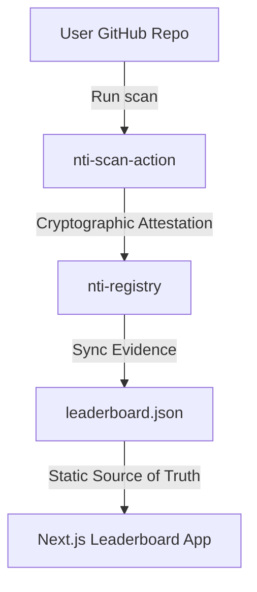

# nti-leaderboard

Cryptographically verifiable compliance leaderboard for AI agent frameworks.



## Overview

`nti-leaderboard` is the definitive public benchmark for AI Agent Security. It solves the problem of fake, self-reported security scores by demanding cryptographic proof via AST static analysis and post-quantum attestations.

## Quick Start

Run a local verification scan using `nti-scanner`:

```bash
pip install nti-scanner
nti-scanner scan . --submit
```

## Features

- **Enterprise Schema:** Static JSON source of truth (`src/data/leaderboard.json`) backed by `NTI-Registry`.
- **Cryptographic Attestations:** Post-quantum signatures (`ML-DSA-5`) and SHA-256 attestation hashes.
- **Deep Tech UI:** Pure dark mode glassmorphism UI with expandable AST findings.
- **Reproducibility Engine:** Self-service verification instructions.

## License

[Apache 2.0](LICENSE)
